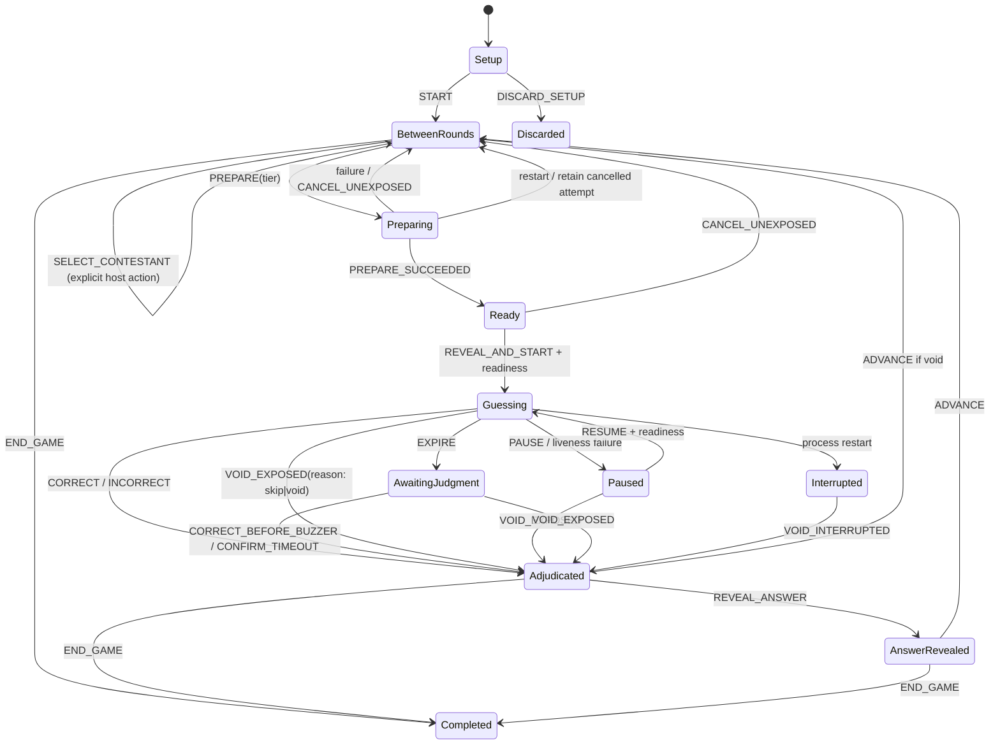

## Context

Planning only; no game code, schema changes or dependencies are installed. See proposal.md for motivation. Baseline commit inspected: `6246946` (official favicon), with a clean working tree before this change. Formal library collection/device/offline acceptance is owner-deferred, not passed.

### D1. Observed implementation and reusable boundaries

| Area | Observed implementation | Reuse / necessary extension |
|---|---|---|
| Client | `App.tsx` uses local view state; Play/Game Settings disabled; only System and Image Library; no router, viewer root, game timers or window coordination | Enable Play only in its approved milestone; keep the current shell/guards for host. Add an isolated `/display/:sessionId` entry without admin chrome. |
| Server | `server/src/index.ts` initializes storage, native HTTP health/library dispatch and SPA static serving; no upgrade handlers or game service | Add a narrow game dispatcher before library dispatch plus owned service cleanup; preserve health/listen behavior. |
| Storage | `storage.ts`, `library/migrations.ts`: global `user_version=2`, WAL/NORMAL/FKs; four STRICT library/import tables and transactional rebuild; import reconciliation before readiness | Add ordered game migration 3, retaining migrations 1/2 and the configured data root. No wholesale persistence refactor. |
| Domain | `shared/src/library.ts`: nullable `low|medium|high`, `easy|medium|hard`; pending/approved/rejected; flexible participants and partial dates | Compatible with the requested two dimensions. No enum migration or provenance conversion. |
| Classification | `shared/src/classification.ts`: exact nine-cell pure `classify`, tier labels/points, `eligiblePool`, injected-sample `selectCandidate` | Reuse unchanged. Add session-used filtering around these helpers, not another matrix. |
| Eligibility/assets | `library/assets.ts`, `catalog.ts`: current PNG/hash assessment, explicit blockers/503 on uncertainty; stored IDs and ID-based image routes | Reuse private observation helpers. Add pinned per-round bytes and public game projections; do not send `ScreenshotSummary`/MatchSummary verbatim to contestant devices. |
| Writes | Repository and HTTP use CAS revisions, immediate transactions, runtime bounds, exact origins/custom header; raw answers are available to LAN library readers | Reuse conventions and parser/response helpers, preserve existing library policy. New game roles prevent accidental disclosure, not adversarial access to the existing admin API. |
| Branding/style | Local `public/images/name-that-match-horizontal-logo.png` (1387×226), `public/favicon.ico` with versioned HTML link; semantic CSS Modules and `styles/tokens.css` | Reuse actual official assets; no image extraction from comps, remote font or CDN. |
| Tests | Vitest/jsdom/Testing Library, temp-root/allocated-port helpers, import fixtures, exhaustive classifier tests, persistence/HTTP/client suites | Use the same patterns. Archived last full result is 310 passing tests; not rerun or claimed as a new baseline result in this planning turn. |
| Networking | Default loopback 3001, Vite 5173 `/api` proxy without `ws:true`, deliberate LAN origin/host config; only HTTP | No existing gameplay, multi-window or WebSocket synchronization. `ws` 8.22.1 exists transitively under jsdom, not as a production dependency. |

Current `docs/foundation-review.md` contains older statements that only health contracts/no library exist. Those are stale relative to actual code and current capability specs; correct current guidance during approved implementation, not archived records or this planning turn. The foundation spec's shell/runtime gameplay exclusions also need the explicit delta supplied here. Library ML-12/14/15 are scoped exclusions of that earlier library change, not authority to implement gameplay inside the library module.

All eight comps were inventoried; seven game comps were visually inspected:

| Comp | Useful visual reference | Do not infer |
|---|---|---|
| `00CE997D-1254-403F-A4DB-7604960EFC0C.PNG` | Shuffle/preparation progress | Real unused screenshots may not flash; animation is not a selection engine. |
| `CA849EE2-D22F-4608-9D00-31E5B7C452B7.PNG` | Hidden challenge placeholder and reveal affordance | One shuffle button does not define timer/host authority. |
| `575F3CFE-1CE3-4B4A-A16A-6019994EBF0C.PNG` | Large screenshot/timer; centered 1080×960 reel-safe annotation | File dimensions/guide artwork are not a production framebuffer specification. |
| `989C475C-D7F3-4085-A2AA-5F04BF4C8974.PNG` | Tier choice and point prominence | Its Easy/Medium/Hard tier captions must not replace independent visual difficulty. |
| `5D88B9D9-C4CF-4DC2-9E45-83B1E9FE6000.PNG` | Correct feedback and answer details | Outcome and answer reveal remain separate controlled steps. |
| `122CF989-63D3-4943-9D0E-CA6C78ACA68F.PNG` | Incorrect feedback/answer reveal | No automatic grading, fixed date precision or required promotion logo asset. |
| `9BD6879B-FE7A-44E5-A0EF-17B21F59F03A.PNG` | Scoreboard hierarchy and legend | Example ranking places a 5 below a 3; actual ranking must sort real totals, not copy it. Three columns do not define game length. |
| `Neon Wrestling Match Library.png` | Existing administration only | Not a contestant game screen. |

The exact matrix is already implemented and exhaustively tested. Current schema-2 inputs stay unchanged; schema 3 adds game storage only. Existing legacy 1→2 ordinal mapping remains historical and must run once for older installations, never again for current data.

## Goals / Non-Goals

**Goals:** One deterministic domain engine, bounded side effects, durable command/score outcomes, separate private/public presentation, clear filming controls, consistent local Studio/Road behavior and truthful verification evidence.

**Non-Goals:** New framework/state manager/router requirement, cloud backend, automatic spoken/text answer validation, multiplayer contestant input, anti-cheat system, audio/recording/export, bonuses enabled by default, arbitrary score editing, undo/reopening completed games, normalized rosters or library redesign. Do not implement any milestone on the strength of this planning request.

## Decisions

### D2. Confirmed rules versus proposals requiring review

**Owner-confirmed in this planning conversation:** C1 block every screenshot of an exposed match for the whole session; C2 Incorrect ends the attempt for zero; C3 host ends manually and sees winner/tie; C4 explicit Correct before buzzer may be entered after expiration. The supplied nine-cell matrix, ten-second window and host judgment are fixed inputs.

The owner has approved P1–P3 below. P4–P9 and the WebSocket dependency remain recommendations requiring final approval. Existing C1–C4 and read-only displays remain confirmed even where a recommended policy repeats them; those overlaps do not approve the rest of that policy. Approval of individual decisions does not authorize implementation or dependency installation.

| ID | Status | Consolidated policy | Boundary / trade-off |
|---|---|---|---|
| P1 | Approved | Exactly 1–2 contestants: one for solo gameplay, two for head-to-head. Reject every other count. No tournament/bracket functionality. | Replaces the former 1–8 proposal throughout contracts, layout and tests. Existing proposed technical defaults below are not newly approved by this count decision. |
| P2 | Approved | Host explicitly selects activeContestantId; Advance retains it until the host uses Switch contestant between rounds. Immutable round contestantId is captured at preparation and owns all scoring. Reject switches during an attempt. Contestant displays remain read-only. | No automatic alternation, fairness quota or silent historical reassignment. |
| P3 | Approved | Host Pause freezes authoritative remainder; Resume continues that remainder. Void and Skip give zero, retain exposed-match exclusions and history, and never restart the same round. Preparation alone is not exposure. | One canonical void transition with a reason distinguishes a passed clue (skip) from an invalid/abandoned attempt (void); no duplicate scoring/advance path. Exact state/receipt behavior is in D4. |
| P4 | Recommended; C1 match blocking already approved | Exclude the whole exposed match across contestants/tiers. Separately exclude exact previously exposed image hashes where feasible using saved SHA-256 and bounded candidate verification during preparation. Honor eligibility/matrix and report empty tiers explicitly. | Hash protection handles retained duplicate content under different IDs; it is not match identity or perceptual dedupe and adds no image-processing work to countdown/judgment. |
| P5 | Recommended | One Node authority; full reconnect snapshots ordered by epoch/revision/connection. Auto-pause on detected primary-display or host-liveness loss with actual remainder; expiry wins; no auto-resume, score or Advance. Secondary loss does not pause. | Timer remains server-owned even when a display is unavailable. Detection delay consumes time; a read-only display never pauses/scores independently. |
| P6 | Recommended | Persist session, immutable owners, exposure/history, outcomes, score events and receipts. Recover unfinished games with explicit host action; guessing at crash becomes interrupted/void-only, known paused remainder stays paused. | No countdown reset or wall-clock inference. Committed judgments remain final; repeated commands cannot score again. See D6 recovery table. |
| P7 | Recommended; read-only display already approved | Host enters verbal Squash Match / Competitive Match / Deathmatch choice, which selects the eligible pool. The unchanged matrix derives each screenshot's tier/points. | Host selects a requested pool, not an editable tier on a screenshot; no contestant mutations or extra confirmation framework. |
| P8 | Recommended | Defer event/year/discretionary bonus points, undo and retroactive score editing; keep a deterministic auditable base-score ledger. | No speculative extension registry or score-correction framework. A later feature needs approval. |
| P9 | Recommended; C2–C4/manual end already approved | Host explicitly reveals the answer and explicitly advances. Correct/Incorrect apply in guessing; Correct before buzzer applies only after expiry. Reveal/Advance never award points. Host manually ends and sees winner/tie. | Outcome feedback is separate from answer reveal; Advance retains contestant selection. Existing answer-before-Advance/void exception is recommended below, not newly approved. |

Existing technical defaults retained for artifact approval: unique trimmed case-insensitive names ≤60 Unicode code points, fixed roster after Start, one nonterminal session; pause covers the clue; answer reveal before Advance except explicit void; and atomic screenshot Reveal & start after primary decode. The previous P9 referred to that last screenshot/timer recommendation. P9 now names answer reveal/advancement as requested; the separate screenshot-exposure recommendation stays in GR-02/D6 pending final artifact approval. No scheduled-future-reveal barrier is added. Manual completion has no fixed round quota under confirmed C3.

Additional technical approval: direct `ws` production dependency plus its TypeScript declarations for milestone 6. No install until explicitly approved. Details for declaration package/version must match the chosen supported release when implementation reaches that gate; do not pin to the observed dev-transitive version automatically. The [official ws documentation](https://github.com/websockets/ws) supports integrating an existing HTTP server, heartbeat/broadcast and a native browser WebSocket client. No Socket.IO, optional native addons or compression is required.

### D3. Domain ownership and source layout

Proposed focused boundaries (future files, not created now):

- `shared/src/game/`: JSON-safe session/phase/command/snapshot unions, runtime guards, rules version and pure transition/projection/used-pool logic. No React, sockets, SQL, filesystem or timers.
- `server/src/game/`: single active-session service, clock/random injection, library observation/asset pinning, transactional repository/migration, HTTP adapter and later WS adapter. Only this service commits commands/scores; one process per data root remains the operating contract.
- `client/src/game/`: host components, isolated contestant root, small transport/clock hooks and CSS Modules. They render snapshots and send intent, not calculate authoritative outcomes or maintain a second game engine.
- Existing library repositories/assets remain library concerns. Reuse them through an application-owned observation adapter. No direct client SQLite/filesystem, inferred video-to-match grouping or full `ScreenshotSummary` broadcast.

A single in-process command lane serializes operations for the active session; SQLite CAS/constraints protect against stale/concurrent writers. External image validation happens before short commit transactions; recheck selected screenshot/parent revisions before reservation and again before reveal. Import work and other tabs can still edit the library; no new global library mutation lock is proposed. Preparation does not run during guessing.

### D4. Typed state machine and commands

Conceptual discriminated unions, to be implemented only after approval:

```typescript
type Session = Setup | Active | Completed | Discarded;
type ActivePhase = BetweenRounds | Preparing | Ready | Guessing | Paused |
  AwaitingJudgment | Adjudicated | AnswerRevealed | Interrupted;
// Each member has its own required fields; no bag of nullable fields.
type Guessing = { kind: 'guessing'; roundId: UUID; timerGeneration: number;
  startedAtMonoMs: number; deadlineMonoMs: number; context: RoundSnapshot };
type Paused = { kind: 'paused'; roundId: UUID; remainingMs: number;
  reason: 'host' | 'primary-display' | 'host-connection'; context: RoundSnapshot };
type AwaitingJudgment = { kind: 'awaiting_judgment'; roundId: UUID;
  expired: true; remainingMs: 0; context: RoundSnapshot };
type Adjudicated = { kind: 'adjudicated'; roundId: UUID;
  // Void metadata distinguishes skip, host void and interrupted recovery.
  outcome: 'correct' | 'incorrect' | 'timeout' | 'void'; baseAward: 0|1|2|3 };
```

The sample is a shape definition, not runnable code. Authoritative state carries session UUID, monotonically increasing safe-integer `stateVersion`, rulesVersion=1, roster/order, explicit session `activeContestantId` and current round. Each round separately records immutable `contestantId`, copied from `activeContestantId` when PREPARE creates the attempt. Scoring always uses that round owner, never the session's later active selection. SELECT_CONTESTANT changes only session selection and revision, not round history, score ownership or phase. It remains legal only between rounds; reject it while any attempt is preparing, ready, guessing, paused, awaiting judgment, adjudicated, answer-revealed or interrupted. Cancel an unexposed attempt or resolve/advance an exposed one before switching. ADVANCE and all outcomes leave the session selection unchanged. Runtime timing includes a process epoch and injected monotonic clock. Historical/public wire state omits server-only fields.



| Command/event | Preconditions and consequences |
|---|---|
| CREATE/CONFIGURE_SETUP | Validate roster/order, persist setup. Discard is terminal without a winner because play never started. |
| START | Current setup + valid contestant + at least one currently eligible match; enter between rounds. Warn if insufficient distinct matches for one turn each; no equal-turn guarantee is invented. |
| SELECT_CONTESTANT | Between rounds only, current host lease/revision and a contestant from this session. Explicitly set activeContestantId through the Switch contestant control; preserve all round owners, scores and current phase. No automatic alternation or selection side effect on Advance. |
| PREPARE(tier) | Between rounds only. Copy activeContestantId into the immutable round contestantId. Commit attempt UUID/preparing revision and accepted command; asynchronously observe/select/validate/pin bytes. Finish with guarded internal success/failure; cancellation/version changes discard late effects. |
| REVEAL_AND_START | Ready + current record revisions + validated pinned bytes + fresh primary display readiness. Atomically mark exposed and start exactly 10,000ms. No separate visible-image waiting phase. |
| CORRECT / INCORRECT | Guessing and received before authoritative deadline after catch-up. Correct computes frozen base points; Incorrect ends for zero. Both stop timing and resolve once. |
| EXPIRE | Internal matching round/timer generation only. Set zero/awaiting judgment; no automatic award or answer reveal. Delayed callbacks cannot extend time. |
| CORRECT_BEFORE_BUZZER | Awaiting judgment only; explicit host attestation of a timely verbal answer. Store late-entry flag, not a fabricated spoken timestamp. Ordinary Correct does not become this action automatically. |
| CONFIRM_TIMEOUT | Awaiting judgment → resolved timeout/zero. No later positive judgment/undo in the proposed MVP. |
| PAUSE / RESUME | Cover image and preserve exact remaining monotonic time. Resume requires decoded/synchronized primary display; only preserved remainder. At zero use expiry. |
| CANCEL_UNEXPOSED | Preparing/ready only; retain cancelled attempt/receipt, release reservation and return between rounds with the same contestant. No exposure/turn/score. A pre-exposure decision to pass uses this cancellation path; it is not an exposed void. |
| VOID_EXPOSED(reason) / VOID_INTERRUPTED | Explicit confirmation, unresolved exposed round only; record outcome void with reason skip (host passes clue), void (invalid/abandoned attempt) or interrupted (recovery). All share the same zero-award finalization and retain used match/image/history. No distinct SKIP state/engine, automatic Advance, destructive delete or reversal of accepted awards. VOID_INTERRUPTED is the restricted recovery form. |
| REVEAL_ANSWER | Resolved only; publish pinned answer, preserving optional date precision and unknown fields. |
| ADVANCE | Answer revealed, or explicit void; clear public image/answer and retain activeContestantId. Return between rounds with Switch contestant available; do not select a different contestant, prepare or start automatically. |
| END_GAME | Between rounds or resolved round; confirmation. Final totals/winner IDs immutable. From unresolved states, resolve/void first. A started game with no scored turns can end with all totals tied at zero. |
| NEW_GAME | Only after completed/discarded; create new UUID/zero totals/empty use history, preserve previous game/library. No in-place reset or reopen. |

State/command summary (all host mutations require the current lease, expected revision and command receipt identity):

| State | Allowed host intent | Disallowed effects |
|---|---|---|
| Setup | Configure 1–2 contestants/starting selection, Start, Discard setup | No round, image exposure or award. |
| Between rounds | Switch contestant, choose requested tier/Prepare, End game | No judgment, answer reveal or automatic rotation. |
| Preparing | Cancel unexposed | No reveal, countdown, scoring or contestant switch; stale completion is discarded. |
| Ready | Screenshot Reveal & start with current readiness, Cancel unexposed | No visible clue before exposure, answer reveal or scoring. |
| Guessing | Correct, Incorrect, Pause, Skip/Void; internal Expire | No contestant switch, fresh-timer restart, answer Reveal or Advance. |
| Paused | Resume preserved remainder after readiness, Skip/Void | No ordinary judgment or fresh timer. |
| Awaiting judgment | Correct before buzzer, Confirm timeout, Skip/Void | No ordinary Correct, extra guessing, automatic answer or award. |
| Interrupted | Void interrupted | No resumed unknown countdown or automatic award. |
| Adjudicated | Answer Reveal, End game; Advance only if void | No new judgment, score edit or contestant switch. |
| Answer revealed | Advance, End game | No second award or round-owner change. |
| Completed / discarded | Explicit New game | No changes to prior scores/history. |

Internal transitions (preparation success/failure, expiry, liveness loss, recovery) use the same guards/commit boundary. A rejected command cannot be repurposed into another action. Answer-before-Advance and primary-display recovery details remain recommended for final approval, while approved controls and existing judgments stay authoritative.

A preparation attempt has a stable attempt ordinal; only exposure allocates the next visible global turn ordinal. Cancelling an unseen attempt does not create a gap in filmed turn numbering. Turn number is not an inferred fixed cycle or the comp's three-round scoreboard. Cancelled attempts are terminal historical records, not another active phase. Same command ID/content replays its accepted receipt without effects; a new ID is evaluated against current state/revision and cannot repeat a completed transition. Legitimate later Pause/Resume cycles remain allowed while time remains; each uses the actual preserved remainder, never fresh time. History retains attempt owner, exposure flag, void/cancel reason, preserved remainder, judgment/late-entry metadata and receipt references; no history is deleted on Skip, Void or New Game.

### D5. Selection, snapshots and exposure semantics

Use the server catalog's current eligibility assessment, then `eligiblePool(tier)`, then exclude exposed match IDs, screenshot IDs and proposed P4 exact hashes. Match exposure protection is mandatory independently of content equality. Use saved screenshot SHA-256 for cheap duplicate lookups and the existing bounded selected-file verification during preparation; no per-tick or countdown/judgment-command image hashing, perceptual processing or speculative image cache. Asset uncertainty fails preparation clearly; never bypass eligibility/hash protection silently. Stable ordering is captured time then screenshot UUID. Production injects an unbiased random candidate index using Node crypto; pure helper tests inject controlled samples/indexes. A match with more eligible frames has more candidate rows initially; this is uniform screenshot selection, not explicit match weighting. Do not silently switch to uniform-match selection or enforce 2/9–5/9–2/9 quotas.

Host availability shows both eligible unseen screenshots and distinct unseen matches per tier; tier counts can overlap in match identity and must not be summed as guaranteed round capacity. Empty/exhausted tier is an explicit no-candidate result with no turn/used-state mutation. All-zero eligibility prevents Start; deficient counts warn without fabricating content or silently selecting a different tier.

`RoundSnapshot` pins its assigned contestant UUID, screenshot/match UUIDs, both record revisions, SHA-256/dimensions/byte size, participant/promotion/event/known partial date/stipulation/championship fields, obscurity, visual difficulty and rulesVersion. It does not include original capture source titles on the public side. Compute tier/points from frozen inputs using the same classifier. The host's requested tier is a selection intent only; it cannot override those derived inputs. No new editable/persistent library tier column. The committed score award is historical fact, not a redundant live library classification; changing the library later does not rescore a round.

Prepare reserves but does not mark seen. Reveal commits exposure before any visible snapshot is published, conservatively burning the match even if delivery fails before confirmed paint. This avoids reusing an image that might have been seen. Pre-reveal cancellation releases it; post-exposure void retains it. Session used sets are derived from persisted exposed rounds, not independently editable browser arrays.

Pin only the current round's verified image bytes in a bounded server buffer, at most the configured per-image limit. Use a session/round asset route and authenticated fetch→Blob URLs, not raw source filenames or a public Match/Screenshot summary. Revoke browser object URLs and release server buffers on disposal. Ready-stage library edits block reveal rather than silently changing the selected answer. After exposure, buffered bytes and frozen context remain stable; on recovery re-read only the app-owned image and verify the pinned hash. For a recoverable unresolved exposed round that needs its clue, missing/changed bytes cause interruption, not another image substituted under the same round ID. Already committed judgments/awards and answer snapshots remain intact; show an unavailable-image status instead of overwriting them with a void. No copies, transformations, staging exposure or writes to original captures.

### D6. Timer, readiness and recovery

Inject server monotonic `now()` and scheduling for tests. Store explicit running deadline/generation in memory; do not decrement a mutable integer every second. Every incoming command catches up due timer transitions before evaluating its expected current phase/revision. A delayed event-loop callback can delay delivery but cannot make a post-deadline ordinary Correct valid. Exposure/scoring/phase changes increment stateVersion; clock samples and liveness do not write SQLite every frame.

Primary display loads/decodes the opaque round image while covered, sends readiness tagged with server epoch, round identity, image identity and display connection generation, and periodically reports liveness. Only the host designates the primary; extra viewers never gate a round. Selecting a different primary is allowed between rounds/while paused, not silently during guessing. Reveal/resume requires current readiness.

Proposed timing defaults: heartbeat each 1s, primary/host loss after 3s without liveness, reveal readiness/clock sample age ≤3s, synchronization RTT ≤500ms. On detected loss pause with `max(0, deadline-now)`; if already zero settle expiry. Real loss cannot be detected instantly: elapsed time before detection is consumed, never refunded. Reconnection requires manual Resume after fresh readiness. A secondary display's loss does not pause. Clients cover stale content on close/error or a >3s synchronization gap.

Clock observation uses server process epoch + monotonic time, echoed client probe nonce and request/response timestamps. Estimate offset using midpoint/best recent RTT, advance remaining time using browser `performance.now`, clamp at zero and render a ceiling in seconds. Client interpolation never changes server phase/score; zero while awaiting an authoritative update is not a new adjudication. Clock uncertainty or epoch change covers/re-syncs, not a local reset. No wall-clock timestamps from a tablet are accepted as proof of a timely answer.

Atomic server Reveal starts ten seconds after decode readiness, not after a network paint acknowledgment. Display latency can reduce the perceived window by measured local transport delay; no promise of identical physical frame time across TV/tablet is made. Test/measure it under local latency and report limits. A future scheduled reveal/barrier remains an alternative to the retained GR-02/D6 screenshot-exposure recommendation, not P9 answer reveal/advancement or an implicit added feature.

On process restart, reconstruct only committed state. Proposed P6 recovery behavior:

| Last committed state | Recovered state and explicit host action |
|---|---|
| Setup / between rounds | Restore roster/active selection; host explicitly starts or prepares, with no automatic draw. |
| Preparing | Retain the unexposed attempt as cancelled with recovery reason, return between rounds and release reservation. No use/turn/award; host may Prepare a new attempt. Late async completion cannot revive it. |
| Ready, unexposed | Restore covered Ready only after current candidate/image revalidation; fresh display decode and host Reveal required. If invalid, host cancels; do not expose or substitute. |
| Guessing | Commit Interrupted once; retain exposure/owner, cover image, no score. Host explicitly voids; never reconstruct a running deadline from wall time. |
| Paused | Restore known persisted remainder paused, revalidate pinned image and require fresh display readiness plus explicit Resume. Missing/changed clue becomes Interrupted/void-only, not a new ten seconds. |
| Awaiting judgment | Restore zero time and pinned owner/answer; host explicitly chooses Correct before buzzer, Confirm timeout or Void. No automatic answer/score. |
| Adjudicated / answer revealed / completed | Restore committed outcomes, totals, ownership, used sets and accepted receipts; no automatic Advance or rescoring. Unavailable clue bytes do not invalidate an award. |

Last accepted command receipt resolves lost responses. New process epoch invalidates old connection/readiness/lease secrets. The SQLite commit is the recovery boundary; uncommitted effects were never accepted. Graceful shutdown can persist a known paused remainder; unknown running time is never silently restarted.

### D7. Persistence, migrations and transactional invariants

Add migration 3 through the existing global migration sequence, with a focused `server/src/game/migrations.ts` helper if useful. The current `library/migrations.ts` filename/constant is historical; extend registration narrowly and document its global schema responsibility instead of a broad rename/refactor. Preserve migration-1 SQL and migration-2 enum mapping. Fresh 0→1→2→3, populated 2→3 and supported older upgrades must work; newer versions fail without recreation. Update version-bound tests to use supported-version+1 rather than hardcoded 3. Keep WAL/NORMAL/FKs and the full-root stopped-writer backup process.

Proposed five new STRICT tables:

| Table | Principal fields and constraints |
|---|---|
| `game_sessions` | UUID PK; status setup/active/completed/discarded; rules version; positive safe state revision; nullable activeContestantId/current round; next attempt/turn ordinals; timestamps/completion reason. Partial unique index allows only one setup/active session. |
| `game_contestants` | UUID PK, session FK RESTRICT, bounded normalized name/key, setup ordinal restricted to 0 or 1; unique(session, ordinal) and unique(session, normalized name). Roster ownership and approved count 1–2 validated transactionally; ordinal bounds/uniqueness prevent a third row, while the service rejects an empty submitted roster. |
| `game_rounds` | UUID PK, session FK and immutable contestantId FK copied at attempt creation, attempt ordinal, nullable exposure turn ordinal; phase including terminal historical cancelled attempts, selected tier intent, nullable selected screenshot/match FKs until prepared, immutable validated answer/input JSON snapshot, image hash, exposure/time/outcome metadata and paused remainder. Unique attempt/turn ordinals within session; no live tier override. |
| `game_score_events` | UUID PK, session/round/contestant FKs; one base award per round via UNIQUE(round_id); positive 1/2/3 amount derived from pinned inputs; committed judgment/command reference. Zero-point outcomes stay in rounds; no bonus/correction event types in MVP. |
| `game_command_receipts` | Command UUID unique, session/round context, canonical payload fingerprint, accepted result/version and timestamp; stable retries survive process restart. Never persist host/display bearer secrets. |

Use composite ownership FKs where relevant so contestants/rounds cannot belong to another session, with nullable links at setup to avoid invalid intermediate cycles. Score events must reference the contestant assigned to their round, not merely any contestant in that session. Round JSON has JSON-object checks and application validation; revision/ordinal/range/status/outcome checks and session/round-history indexes are mandatory. Add partial unique constraints for exposed (session, match), (session, screenshot) and proposed (session, hash); they independently guard repeat invariants. No deletion UI or cascading library deletes. Preserve all old tables/indexes, raw metadata, reviews, receipts and assets; migration failure rolls back and closes failed startup connections.

Scores are derived from immutable score events, not writable contestant totals. Current phase derives from session status/current-round pointer and that round's phase, avoiding a second persisted competing state blob. Pure-engine in-memory used sets/totals hydrate from these rows. Persist transition, outcome/award, current pointers, exposure history and accepted receipt in one short immediate transaction; publish success/snapshot only afterward. Input/answer snapshots are deliberate historical records, not writes back into library metadata. Recorded historical amounts never change because editorial data changes.

Command service order: validate envelope and lease; settle due expiry once under round/generation guards; look up a prior receipt; replay same fingerprint with original result plus a fresh snapshot; otherwise check expected session/round/version and apply one pure transition with all effects atomically. Authentication/process epoch are transport metadata, not part of stable business fingerprint. Reused UUID/different business payload conflicts. Rejected commands do not publish success. A race while validating selected files is handled by rechecking library revisions at commit/reveal. No asynchronous file reads inside SQL transactions.

Accepted receipts persist for session lifetime; no silent pruning that permits reapplication. Proposed resource caps: 1000 exposed turns, 10,000 accepted commands per session; report a bound before accepting more work. Historical storage grows until a future approved retention/export feature, not an unbounded in-memory log. Preserve completed sessions on New Game. SQLite WAL/NORMAL gives process-restart consistency, not an unconditional guarantee that the last acknowledged transaction survives sudden OS/power loss; stronger durability would need an explicit storage-policy decision.

### D8. HTTP, projections and controller coordination

Keep native HTTP and existing response/error/body/origin conventions. Add game dispatch under `/api/game` before the current catch-all library dispatcher. Health remains unchanged. Minimal proposed routes:

| Route | Responsibility |
|---|---|
| `POST /api/game/control-lease` | Claim an unowned host lease under the configured exact-origin/custom-header policy; return opaque host capability privately. An occupied lease returns busy, not automatic takeover. |
| `POST /api/game/control-lease/renew` | Renew current token; stale token fails. |
| `POST /api/game/control-lease/release` | Current controller explicitly releases its token, pausing a running attempt before invalidating that generation. A new host can then claim and review state. |
| `POST /api/game/sessions` | Create setup with client command UUID and proposed session UUID, allowing idempotent creation. |
| `GET /api/game/current` | Host capability required; recover current nonterminal session without silently creating one. |
| `GET /api/game/sessions/:id` | Role-specific complete snapshot; explicit host/display capability, never an unauthenticated private-answer response. |
| `POST /api/game/sessions/:id/commands` | One command envelope/service for host intent, regardless of Studio/Road. |
| `GET /api/game/sessions/:id/commands/:commandId` | Resolve uncertain accepted receipt with host capability; missing receipt is not proof of a new command's safety without checking current state. |
| `POST /api/game/sessions/:id/displays` | Host registers an audience capability and join link for that session; no public host token. Primary designation is host-only control-plane action. |
| `POST /api/game/sessions/:id/displays/:displayId/status` | Read-only-role readiness/liveness/clock observations during polling milestones; cannot adjudicate. |
| `GET /api/game/sessions/:id/rounds/:roundId/image` | Capability-authenticated verified round bytes for fetch→Blob decoding; no answer/source-bearing filename. |
| `GET /api/game/live` upgrade | Milestone 6 role-aware WebSocket snapshots/liveness/clock channel; host business mutations stay on the same HTTP command lane. |

HTTP uses `Authorization: Bearer <capability>` and `X-Name-That-Match: game` on mutations with exact configured origins. Reuse existing parsing/JSON/error primitives; make only narrowly necessary origin/header composition changes while preserving all library-call defaults. Do not copy the health wildcard CORS policy to game APIs. Error classes: malformed/unknown fields 400; missing/invalid role token 401/403; absent session/round 404; stale/invalid transition/occupied lease 409; semantic setup/pool/image errors 422 (empty pool distinct code); bounded body 413; unavailable storage/recovery 503. Return sanitized codes and current revision/state suitable for reconciliation, not SQL/filesystem paths.

Envelope: `{protocolVersion:1, commandId, sessionId, roundId?, expectedStateVersion, type, payload}` plus current server epoch metadata. Validate runtime discriminants, UUIDs, safe revisions, exact enums, string/array bounds and unknown fields. Native browser WebSocket cannot set an arbitrary Authorization header: its first bounded HELLO sends the role capability in the message body, never URL query/logs. HTTP image fetch can set Authorization before converting bytes to a Blob. Do not render private data in contestant alt text or data attributes.

Private HostSnapshot includes answers, candidate diagnostics, allowed actions, current display readiness, totals and latest bounded turn history. Public DisplaySnapshot is an explicit phase-discriminated allowlist: session/round IDs, explicit activeContestantId and current round contestantId with public names, selected tier, scores and phase; current-round labels/outcomes use the round owner and between-round labels use active selection; image access only for the current prepared/exposed round, timing only as needed, answer fields only after Reveal Answer. Final results omit internal setup notes, tokens, library IDs/provenance and private errors. Host-only data must not reach a display and then be hidden with CSS.

Capabilities/leases are random server-held, process-scoped and role/session-bound; the host controller capability can create/bind the current session. Host renews every second with proposed 3s liveness and 10s control-claim expiry. A disconnected host pauses play at detection; a returning host reviews recovery instead of competing silently. Another tab sees busy/read-only. Deliberate takeover uses release by the current owner, or a new claim after lease expiry/server restart; it invalidates old capabilities/generations and requires current-state review. There is no unauthenticated force-takeover action for an actively renewed lease. Display capabilities are minted by the host and shared through a fragment join link, retained per tab for reconnect; server restart requires a fresh join/rebind. Tokens never enter logs or persistent game history.

This is private trusted-LAN coordination, not account authentication. Origin/custom-header protections prevent foreign browser writes; lease/capability checks separate legitimate roles, but programs on a trusted LAN can attempt to claim a vacant host lease, and current library APIs expose answers/administration to LAN clients. Do not claim anti-cheat isolation or safety on untrusted Wi-Fi. No cloud login, TLS provisioning, account system or library security redesign is smuggled in. A stricter threat model requires a separately approved design.

### D9. Studio, Road and real-time transport

Milestones 2–5 use bounded HTTP polling (proposed 200ms while live, 1s idle) of the same snapshot/clock/readiness contract so local UI can be verified before adding a socket dependency. This is an intermediate implementation, not final Road Mode. Milestone 6 switches both Studio and Road to the same WebSocket snapshot adapter; do not retain a second BroadcastChannel/localStorage authority or fork mode-specific game rules.

WS proposal: direct `ws` runtime dependency, native browser WebSocket, no compression/native addons. Attach to the existing HTTP server with an explicit upgrade path, exact Origin check (reject missing/null/foreign browser origins), supported subprotocol `ntm.game.v1`, HELLO timeout 3s and message-size limit 16KiB. Role snapshots are compact (≤64KiB) with latest-turn history bounded; PNGs travel over the existing local HTTP connection, not WS frames. Validate before effects, limit clients (proposed 4 displays + controller), coalesce stale queued snapshots and close slow clients before unbounded growth (proposed 1MiB backlog / 3s). Ping/pong detects broken sockets; clock probes still identify nonce/epoch. Client display sockets cannot submit scoring commands.

Server messages: `snapshot`, `clock`, `ready_status`, `error`, `heartbeat`; client messages: `hello`, `clock_probe`, `display_ready`, `heartbeat_ack`. Every state frame carries `{protocolVersion, serverEpoch, sessionId, stateVersion, connectionSequence, role, state}`. On initial connect/reconnect send a full role snapshot. Use connection-generation checks to ignore responses from replaced sockets; discard older state revisions, and treat equal-revision state as immutable while accepting fresh transport/clock observations. Never replay host mutations just because a socket reconnects; resolve receipts explicitly.

Reconnect with capped exponential backoff (250ms→5s plus bounded jitter), show a cover, obtain epoch/snapshot, re-decode/reacknowledge image and require manual Resume if paused. Epoch change clears timing estimates and credentials/readiness. A stale ready acknowledgment from another image/round/connection cannot unlock Reveal.

Studio: host stays in the existing app shell's Play view. Contestant `/display/:sessionId` opens only from an operator gesture using `noopener,noreferrer`; no `window.opener`/DOM access to host answers. Handle popup blocking with a copyable/manual link. Placement on external TV is manual; optional Fullscreen requires a gesture inside the viewer. No Screen Details/Window Management permission requirement. A connection status, not a browser window handle, determines readiness. Closing/reloading the primary display invokes the same interruption contract as Road.

Road: use the built Node-served application with deliberate `NAME_THAT_MATCH_HOST=0.0.0.0` and exact laptop LAN origin in `NAME_THAT_MATCH_UI_ORIGINS`; show a copyable local join link, no internet pairing/QR dependency. Do not bind/expose LAN by default. Add Vite `/api/game/live` WS proxy only for local development, preserving `/api` HTTP proxy and original browser Origin; validate the upgrade before accepting it. Physical Android/fullscreen/touch/local Wi-Fi remain actual acceptance checks, not claims inferred from desktop viewport emulation.

Shutdown: reject new commands/upgrades, stop owned timers/readiness/poll jobs, persist a known paused/interrupted checkpoint when possible, close/terminate socket clients with a bounded grace period (proposed 2s), then close HTTP/SQLite resources. Failed listen/startup must release both game and library resources. Existing `server.close()` behavior with upgraded sockets requires explicit tests; never let it hang or close the DB while game writes are pending.

### D10. UI responsibilities, styling and filming layout

| Future component | Responsibility |
|---|---|
| `GameHostPage` / setup form | Server session lifecycle, fixed roster editing before Start, active contestant/tier intent, convenient keyboard-reachable Switch contestant control between rounds, availability and explicit destructive-action confirmations. |
| `HostRoundControls` | State-derived enabled actions, private pinned answer, deadlines/remainder, distinct late judgment, errors/receipts and readiness. No scoring arithmetic. |
| `ContestantDisplayRoot` | Route-role boundary, join capability, subscription/clock state, clean public stage; never render App/library navigation. |
| `ContestantStage` / phase views | Logo, active contestant/turn/tier, covered/visible image, timer, outcome, answer or final results from public snapshots. |
| `Countdown` | Local monotonic interpolation/formatting, zero clamp, restrained accessible updates; no authoritative expiry event. |
| `Scoreboard` / `FinalResults` | Actual totals, stable descending tie-aware rows, per-contestant latest outcomes, all tied leaders. No fabricated rank or fixed three-round layout. |
| Transport/clock hooks | Cancel stale requests, reconnect/snapshot ordering and readiness; no domain state machine copy. |

Reuse official logo/favicon globally; promotion/roster images shown in comps are not supplied assets and are not required. Use plain stored promotion/event text. Reuse game tier details/classifier labels, existing button/form/focus patterns and the navigation-guard contract, not imports of the entire MatchWorkspace hook. Leaving a live host view prompts Stay or Pause-and-leave; never silently abandon a running attempt. Keep existing library unsaved guards intact.

CSS Modules colocated with each game component; globals stay reset/type/tokens. Existing colors, fonts, spacing, radii, focus and reduced-motion foundations remain authoritative. Proposed only shared additions, if repeated need warrants them: game safe-stage logical dimensions 1080/960, bounded large countdown type scale and stage outline thickness. Scope them under a game token layer/selector to avoid restyling library/admin controls. No Tailwind, utility framework, excessive inline styles/!important or remote assets. A dynamic stage scale may be supplied through one scoped CSS variable rather than scattered JSX styles.

Reference composition: center a 1080×960 logical stage on 16:9 desktop/TV; use uniform scale `min(availableWidth/1080, availableHeight/960)` with safe padding. Decorative side gutters can fill a wide TV; essential logo/image/clock/contestant/answer/totals stay inside the stage. Sources use object-fit:contain and measured intrinsic ratios, including 476×360 and 1920×1080. Do not crop a clue to imitate comp imagery. Optional safe-area preview guides are outside clean default output. On portrait/tablet keep the same essential hierarchy, allow a manual landscape/fullscreen suggestion and never require unsupported automatic screen placement.

Host layout uses readable controls and minimum 44px targets, collapsing columns around existing 1100/768px conventions; the public stage is not the dense admin form. Measure 1920×1080 TV, 1366×768 laptop, 768×1024/1024×768 tablet and narrow fallback; record screen size and viewing distance (suggested 2–3m check) rather than promise universal legibility. Long contestant/participant/event text wraps/truncates responsibly with a host preview; never clip an essential timer/score/answer out of the safe stage. Solo/two-contestant scoreboard rows plus totals must fit without a scrolling filmed panel.

Keyboard: meaningful controls with visible focus; optional state-scoped shortcuts ignore text inputs/repeats. Ordinary Correct and late Correct-before-buzzer are not interchangeable shortcuts. Confirmation focus traps/return, image-alt privacy, text+icon outcomes and accessible errors are required. Announce phase/start/expiry/outcome, not every animation frame. Reduced motion replaces abstract shuffle with a static preparing indicator; no random real images, flash/strobe, mandatory sound or animation-dependent transition.

### D11. Verification and milestone approach

Implement only one approved milestone at a time, each with its own review gate. Do not advance on a task list existing. Tasks.md contains exact per-milestone scopes, acceptance/manual expectations and exclusions; all rows stay unchecked in this planning turn.

Automated strategy: reuse temp storage/allocated loopback ports and fixture authorship. Exhaust all nine classification cells against unchanged source, valid/invalid eligibility, exact duplicate hashes under different IDs, cross-video same/different matches, seeded samples, empty/exhausted pools, reservation/exposure/cancel cases and restart-preserved no-repeat history. Test every allowed/forbidden state transition, monotonic time around 10,000ms, delayed callbacks, pause/resume, wall-clock jumps, stale generations, expiry/judgment races and explicit late judgments. Verify solo and two-contestant setup, rejection of 0/3+ and malformed counts, one canonical Skip/Void transition with retained zero-point history, covered Ready cancellation releasing use, Reveal/Advance idempotency without awards, and hash protection outside countdown/judgment. Verify consecutive rounds retain the chosen contestant, explicit switching affects only future attempts, every in-attempt switch is rejected, activeContestantId and immutable round contestantId survive reopen, stale selection/Prepare races cannot reassign ownership, and replaying a judgment after a later switch still references its original owner. Verify zero/positive awards, unique round scoring, changed idempotency payloads, two controllers, lost acknowledgment, failure before/after SQL commit and unsupported schema/rollback. UI tests cover accessible host actions, viewer phase allowlists, keyboard, hidden-answer absence in serialized messages/DOM/URLs/alt text, dirty-navigation guards and corrected library regressions.

Transport tests: initial full snapshot, equal/old revision handling, replaced sockets, role escalation attempts, origin/HELLO/protocol/size failures, pending image decode, high RTT/clock age, packet delay/drop, primary versus secondary loss, host loss, heartbeat/backpressure cleanup and bounded shutdown. Use controlled clocks/latency; both HTTP intermediate and final WS adapters run against the same engine conformance fixtures. Real browser tests use disposable app data and local synthetic/known fixture images, never automatic Downloads discovery.

Per checkpoint run npm test, typecheck, lint, build, strict change validation and whole-project strict validation; record actual results and Git tracking. Planning verification is OpenSpec validation and source/archive-preservation audit only; no new gameplay tests are claimed executed. Final production verification includes true multi-window TV use, actual Android Wi-Fi/reconnect, external-internet disconnection with local network maintained, image load/readiness, full round/score/tie completion and restart. The owner currently lacks a tablet/disconnected-internet setup: automated network simulation/viewport checks may proceed after approval, but mark physical checks deferred until they actually run. This does not rewrite or complete the archived library's seven deferred tasks.

## Risks / Trade-offs

- Late host clicks → distinct approved pre-buzzer attestation; cannot verify spoken timing automatically, and already resolved outcomes remain final under P8.
- Synchronous current PNG/hash work can block the Node event loop → select between rounds, pin one bounded image, test deadline catch-up under concurrent library reads/import traffic and report measured latency; no automatic extra time or speculative permanent cache.
- One chosen match can span tiers → remove it across all pools, show distinct-match capacity and explicit exhaustion; no fairness quota silently added.
- Library edits during play → revision-check before exposure, pinned answer/inputs/bytes afterward; next draw uses fresh data. Different UUIDs for semantically identical bouts remain an editorial data issue, not inferred from source videos.
- Time/network ambiguity → monotonic deadlines, epoch resets, preload readiness, explicit pause/recovery. Detection is delayed and physical frame simultaneity is not guaranteed by WebSockets.
- Crash/power loss → atomic WAL transactions/receipts and no blind replay; preserve backups, distinguish supported process recovery from NORMAL-mode power-loss limits.
- Viewer access versus private host data → allowlist projections and capabilities; existing library APIs mean this is not an adversarial contestant sandbox or untrusted-LAN authentication solution.
- New dependency and sockets expand lifecycle complexity → request ws approval, disable compression/addons, cap messages/clients/backlogs and test listen failure/shutdown with open sockets.
- Small real eligible collection → never imply screenshots equal available rounds, verify empty tiers and warn; do not access/migrate operational data during planning.
- Comp artwork versus working screen → use supplied official branding and native CSS; do not copy fixed scores, erroneous rank or direct tier/difficulty equivalence.

## Migration Plan

After explicit artifact/policy approval, implement M1's backed-up schema-3 additions with fixtures first. Preserve schema-2 library values/reviews/capture v1 and earlier migration text. Do not mark current library/device acceptance complete. Ship host-only controls behind their milestone capability; add isolated display route before enabling real filming. Verify intermediate polling and then replace transport wiring with the approved WS adapter for both modes; no cloud deployment. Install no runtime dependency until its dedicated approval. Current docs/AGENTS updates belong to implementation milestones, not this planning turn.

Before operational upgrade: stop all writers/watchers/tools and verify a whole-root WAL-safe backup with screenshots/sidecars. Migration failure rolls back without replacing the database. Rollback uses compatible prior code and a complete pre-upgrade backup restored to a different root; do not run old code on schema 3 or reverse-guess score history. No destructive data reset. Archive only after implementation/verification and an explicit owner request, preserving any honestly deferred physical checks.

## Approval checkpoint

C1–C4 and P1–P3 are approved: 1–2 contestants, host-controlled selection/read-only displays, and pause/remainder/zero-point void-skip/no-restart controls. P4–P9 remain recommended for final approval except their already confirmed overlapping rules. The detailed technical defaults, schema/role/lease/recovery approach, retained atomic screenshot Reveal & start recommendation and proposed `ws` dependency remain pending artifact/dependency approval. These are explicit decisions to accept/revise before implementation, not deferrable unknowns disguised as tasks. No game implementation is authorized yet. Hardware/browser details can be recorded during manual verification; their absence is not filled in with passing claims.

## Implementation authorization

The owner approved the consolidated plan (including P4–P9 and retained technical defaults) with “ok this looks good” and subsequently authorized beginning Milestone 1 with “lets begin”. Earlier pending/plan-only wording records the proposal review stage; this approval supersedes it for the approved plan. Implement Milestone 1 only, stop for review before Milestone 2, and do not archive. No dependency is installed in Milestone 1; the dedicated Milestone 6 dependency-installation checkpoint remains.

After completing Milestone 1 manual verification, the owner explicitly authorized Milestone 2 in the “Game Experience MVP, Milestone 2” implementation request: tasks 3.1–3.6 only. This extends the implementation authorization through the host-controls/screenshot-selection checkpoint; it does not authorize Milestone 3, dependencies or archival. See `milestone-2-verification.md` for its implementation and verification evidence.

The “Game Experience MVP, Milestone 3” request records Milestone 2 manual acceptance and explicitly authorizes tasks 4.1–4.7: contestant display/countdown and required live host controls only. Portrait composition keeps the screenshot above the timer; the full uniform reel-safe staging, Studio launcher/fullscreen, full-game progression and WebSocket milestones remain unstarted. No dependencies or archival are authorized. See `milestone-3-verification.md` for evidence.
